# Как делать мультики через терминал

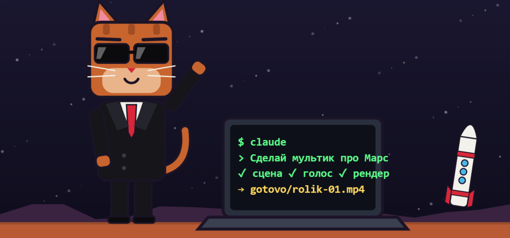

Что внутри

Пошаговая инструкция: от создания аккаунта до публикации готового ролика. Она подходит для любого мультика, героя и темы. Здесь вы получаете технологию, а идеи можете брать свои.

Как читать: идите по порядку. Команды копируйте из серых блоков, а зелёные блоки показывают, что шаг выполнен.

> 🐱 **От KARAOKE_KOT.** Привет, я кот-мэр MARS CITY — канала, где город на Марсе строится из подписчиков. Всё в этом обучении — тот же процесс, которым сделаны наши серии: «777 домов на Марсе за ночь», «За ночь IMEN захватила участки», сериал «Космодром за 1 рубль». Блоки с котом — это наши добавки: какие навыки и агенты мы реально используем и как.

## Карта пути

| Этап | Главы | Ориентир | Результат |
|---|---|---|---|
| Подготовка | 0–5 | 1–2 часа | Claude Code работает, папка создана |
| Первый результат | 5.1 | 15 минут | Короткое тестовое видео |
| Свой стиль | 6–9.1 | 1–2 часа | Герой, стиль, сценарий, голос и шаблоны |
| Первый ролик | 10–12 | От нескольких часов | Готовый ролик опубликован |
| Рост | 13–14.3 | По мере необходимости | Данные, Telegram и своя система работы |

Время указано как ориентир: оно зависит от компьютера, интернета и сложности ролика.

На каждом этапе смотрите блок «Проверка». Если результат совпал, идите дальше. Если нет, откройте главу 11.

---

# Часть 1. Подготовка

## 0. Перед стартом

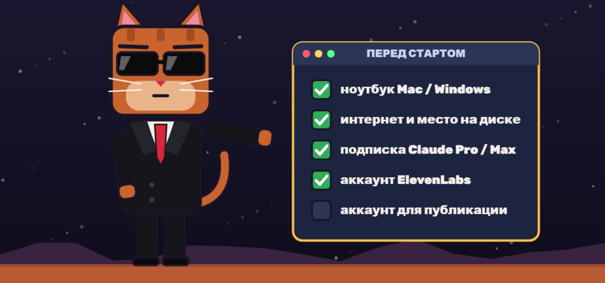

Вам понадобятся:

- ноутбук или компьютер: macOS 13+ или Windows 10 версии 1809+, минимум 4 ГБ оперативной памяти
- интернет и свободное место на диске
- платная подписка Claude Pro или Max
- аккаунт ElevenLabs для озвучки
- аккаунт Instagram или другой площадки для публикации

Важно до оплаты

- Claude Code работает только в странах, которые поддерживает Anthropic. России в этом списке нет. Проверьте актуальный список стран.
- Обходы ограничений в этой инструкции не описаны: они нарушают правила сервиса, и аккаунт могут закрыть.
- Пользоваться сервисом можно с 18 лет.

---

## 1. Как всё устроено

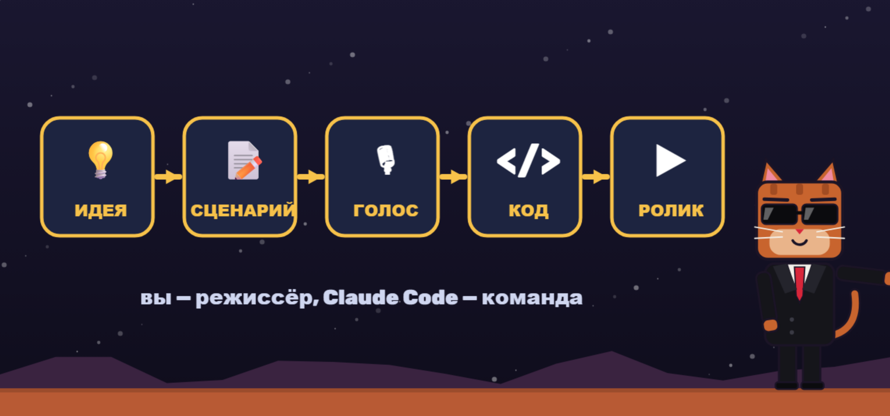

Вы не рисуете каждый кадр и не пишете код вручную. Вы работаете как режиссёр: придумываете идею и описываете результат. Claude Code пишет код, строит 3D-сцену, анимирует её и собирает видео.

Путь каждого ролика одинаковый:

1. Вы придумываете идею и героя.
2. Пишете и утверждаете сценарий.
3. Озвучиваете его.
4. Описываете сцены в задании для Claude Code.
5. Проверяете тестовые кадры.
6. Запускаете полный рендер и публикуете ролик.

Внутри обычно работает такая связка: Three.js строит 3D-сцену, браузер без окна снимает кадры, ffmpeg собирает их в видео со звуком. Запоминать это не нужно: Claude Code настроит всё сам.

> ✅ Проверка: вы можете своими словами объяснить, что делаете вы, а что делает Claude Code.

---

## 2. Аккаунт и подписка

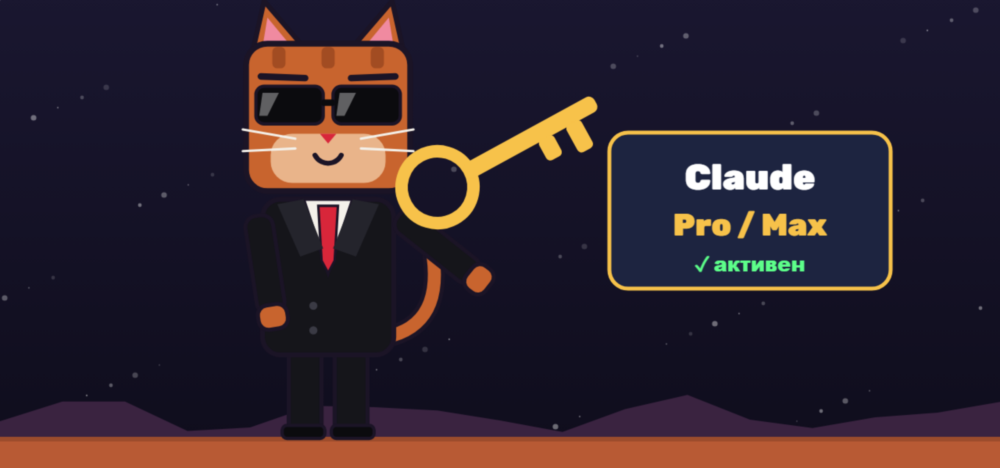

1. Зарегистрируйтесь на claude.ai.
2. Откройте настройки и раздел с подпиской.
3. Выберите тариф. Claude Code входит в личные тарифы Pro и Max. Для старта подойдёт Pro. Max берите, если часто упираетесь в лимиты. Актуальные цены смотрите на странице тарифов.
4. Оплатите подписку.

Если лимит закончился, он обновится позже. Сервис покажет время обновления.

> ✅ Проверка: вы вошли на claude.ai и видите активный тариф Pro или Max.

---

## 3. Запускаем терминал

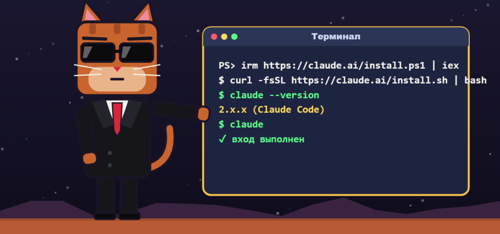

Как открыть:

- Mac: нажмите Cmd + Пробел, введите Terminal, нажмите Enter.
- Windows: откройте меню Пуск, введите PowerShell, откройте программу.

Вставьте команду для своей системы и нажмите Enter.

Mac

```
curl -fsSL https://claude.ai/install.sh | bash
```

Windows

```
irm https://claude.ai/install.ps1 | iex
```

Закройте терминал, откройте его снова и проверьте установку:

```
claude --version
```

Должен появиться номер версии. Затем запустите программу:

```
claude
```

Войдите тем же аккаунтом, что и на claude.ai. Если вход не предложен или выбран другой аккаунт, напишите внутри программы:

```
/login
```

Если на компьютере задана переменная ANTHROPIC_API_KEY, Claude Code будет тратить деньги с API-ключа, а не лимиты подписки. Новичку она не нужна.

Чтобы выйти из Claude Code, напишите /exit.

> ✅ Проверка: команда claude --version показывает номер версии, а claude запускается после входа в аккаунт.

---

## 4. Нужные программы

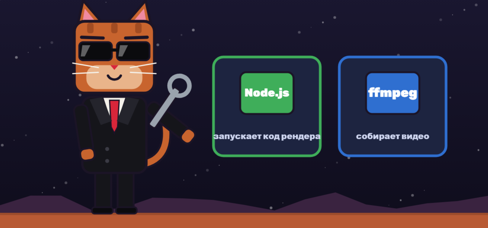

Node.js запускает код рендера, ffmpeg собирает видео.

Mac

Сначала установите Homebrew:

```
/bin/bash -c "$(curl -fsSL https://raw.githubusercontent.com/Homebrew/install/HEAD/install.sh)"
```

Если установщик покажет дополнительные команды, выполните их. Затем:

```
brew install node ffmpeg
```

Windows

```
winget install OpenJS.NodeJS.LTS
winget install Gyan.FFmpeg
```

Перезапустите терминал и проверьте:

```
node -v
ffmpeg -version
```

Если появилась ошибка, запустите Claude Code и напишите: «Проверь Node.js и ffmpeg, объясни ошибку и помоги установить». Перед установкой он спросит разрешение.

> ✅ Проверка: команды node -v и ffmpeg -version показывают версии программ.

---

## 5. Папка проекта

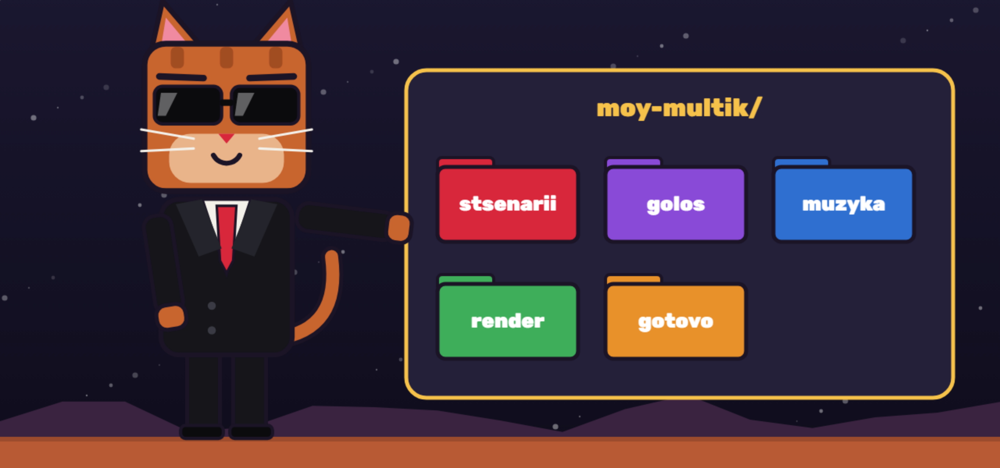

У каждого проекта своя папка на рабочем столе. Лучше называть папки латиницей и без пробелов.

Mac

```
cd ~/Desktop
mkdir moy-multik
cd moy-multik
mkdir stsenarii golos muzyka render gotovo
claude
```

Windows

```
cd $HOME\Desktop
mkdir moy-multik
cd moy-multik
mkdir stsenarii, golos, muzyka, render, gotovo
claude
```

Если рабочий стол находится в OneDrive, откройте его папку через Проводник и нажмите правой кнопкой «Открыть в терминале».

| Папка | Что лежит |
|---|---|
| stsenarii | тексты роликов |
| golos | файлы озвучки |
| muzyka | фоновая музыка с правом на использование |
| render | код сцены и рендера |
| gotovo | готовые видео и обложки |

В каждом проекте запускайте Claude Code из его папки. Так он видит нужные файлы.

> ✅ Проверка: в папке проекта есть пять вложенных папок, и claude запущен из неё.

---

## 5.1. Первый результат за 15 минут

Пока не думайте о сценарии и голосе. Вставьте задание ниже и получите первое видео.

```
Сделай в папке gotovo тестовое видео test.mp4: 1080×1920, 30 fps, 5 секунд, H.264 yuv420p, без звука.
На чёрном фоне появляется простая оранжевая 3D-фигура, камера плавно её облетает.
В конце на экране появляется слово «Готово».
Проверь файл через ffprobe и покажи мне результат проверки.
```

> ✅ Проверка: файл gotovo/test.mp4 открывается, движение плавное, слово на экране читается.

---

# Часть 2. Ваш стиль

## 6. Идея и герой


Сначала ответьте на четыре вопроса:

- Кто герой и как он говорит?
- Что зритель получает от ролика?
- В каком мире всё происходит?
- Какое действие вы ждёте от зрителя?

Придумайте своего героя. Не используйте чужих персонажей, логотипы и узнаваемый стиль известных брендов.

Попросите Claude Code создать файл стиля:

```
Создай файл style.md для вертикальных мультиков.
Тема: [ваша тема].
Герой: [внешность, возраст, характер].
Мир: [где происходит действие].
Визуал: [например, воксельный, пластилиновый, плоский 2D].
Опиши палитру с HEX-цветами, шрифты, субтитры, движение камеры и запреты.
Сделай одну тестовую картинку с героем и покажи её мне.
Продолжай только после моего подтверждения.
```

Файл стиля важнее всего: он делает все ролики одного проекта похожими друг на друга.

> 🐱 **Как это сделано у нас.** Герой MARS CITY — кот-мэр KARAOKE_KOT: блочная рыжая голова с ушами, чёрные очки, чёрный костюм, белая рубашка, красный галстук. Мир — город на Марсе, где каждый дом принадлежит подписчику. Палитра: фон `#141829`, акцент золото `#f7c24a`, марсианская земля `#b85a34`, красный `#d8263a`, бирюза `#4fd6e8`. Шрифт субтитров — Rubik 900 с тёмной обводкой. Библия канала с героями и правилами лежит в `stsenarii/kanal-bibliya.md` — это наш «style.md на максималках». Для второго сериала («Космодром за 1 рубль») — свой файл `stsenarii/kosmodrom-bibliya.md`: робот Ключ говорит только надписями на экране, потому что голос у нас один.

### Библиотека визуальных стилей

Чтобы сравнить стили без лишних затрат, попросите:

```
Сделай для моей сцены три контрольных кадра в разных стилях.
Не делай анимацию. Покажи кадры рядом и объясни, какой стиль лучше подходит теме.
Используй только мои оригинальные объекты.
```

> 🐱 **Как это сделано у нас.** Для «Космодрома» мы сделали одну и ту же серию в 2D и 3D и отдали обе версии агентам на разбор. Победило 2D: чище на телефоне и в 3–5 раз дешевле для 30 серий. 3D оставили для эффектных финалов.

> ✅ Проверка: style.md создан, а герой и стиль подтверждены тестовой картинкой.

---

## 7. Сценарий

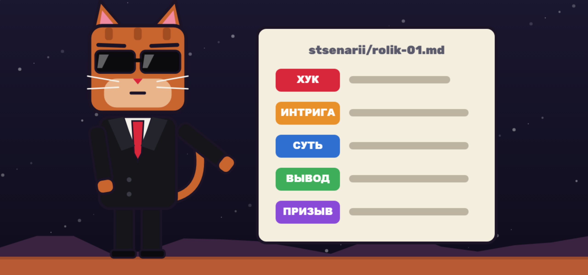

Хороший короткий сценарий строится так:

1. Хук: первые 2–3 секунды с сильной фразой, без приветствий.
2. Интрига или проблема: зачем смотреть дальше.
3. Суть: одна главная мысль простыми словами.
4. Вывод: что зритель должен запомнить.
5. Призыв: подписаться, написать комментарий или перейти дальше.

Ориентир: 40–45 секунд это около 100 слов.

Шаблон:

```
Напиши сценарий на [длина] секунд.
Тема: [тема].
Аудитория: [кто смотрит].
Главная мысль: [одна мысль].
Тон: [как говорит герой].
Структура: хук, интрига, суть, вывод, призыв.
Разбей текст на сцены. Для каждой сцены укажи:
ГОЛОС: что говорит герой;
КАДР: что видно на экране;
ТЕКСТ: что написано на экране.
Сохрани результат в stsenarii/rolik-01.md.
```

Не начинайте озвучку, пока не утвердите текст.

> 🐱 **Как это сделано у нас.** Сценарий мы пишем таблицей «Время | ГОЛОС | КАДР | ТЕКСТ на экране | ЗВУК» — так сразу видно, где кадр пустой. Перед озвучкой сценарий проверяет рой агентов (глава 9.1): хук-мастер, психолог, трендолог, звукорежиссёр, визуал и прогнозист спорят между собой и ставят шансы на взлёт. Правило канала: никаких пересказов прошлых серий — каждый ролик новое событие.

> ✅ Проверка: сценарий сохранён в stsenarii, а вы прочитали его вслух и уложились в нужную длину.

---

## 8. Голос


1. Зарегистрируйтесь на ElevenLabs.
2. Выберите голос под героя.
3. Вставьте утверждённый текст.
4. Сделайте один дубль, чтобы экономить кредиты.
5. Если не подошла одна фраза, переозвучьте только её.
6. Сохраните файл в папку golos как rolik-01.mp3.

Для коммерческих роликов проверьте условия своего тарифа ElevenLabs.

Таймстампы показывают, когда звучит каждое слово. По ним синхронизируются субтитры и смена сцен. Попросите:

```
Получи таймстампы каждого слова из golos/rolik-01.mp3.
Используй ElevenLabs Speech-to-Text. Если ключа нет, спроси меня один раз
или используй локальный whisper.cpp.
Сверь слова со сценарием и сохрани результат в render/words.json.
```

> 🐱 **Как это сделано у нас.** Текст для ElevenLabs мы отдаём одним сплошным абзацем, а паузы ставим только троеточиями «...» — без тегов и абзацев. Настройки голоса рассказчика: стабильность 0.40–0.45, сходство 0.75, стиль 0.20, скорость 1.00–1.05. Если таймстампов нет, синхронизацию делаем по паузам голоса: Claude находит тишину в mp3 через ffmpeg (`silencedetect`) и привязывает каждую фразу к своей сцене.

API-ключ не публикуйте и не отправляйте другим людям. Если он случайно попал в открытый доступ, удалите его в настройках ElevenLabs и создайте новый.

> ✅ Проверка: файл golos/rolik-01.mp3 проигрывается, а render/words.json создан.

---

## 9. Как писать промпты

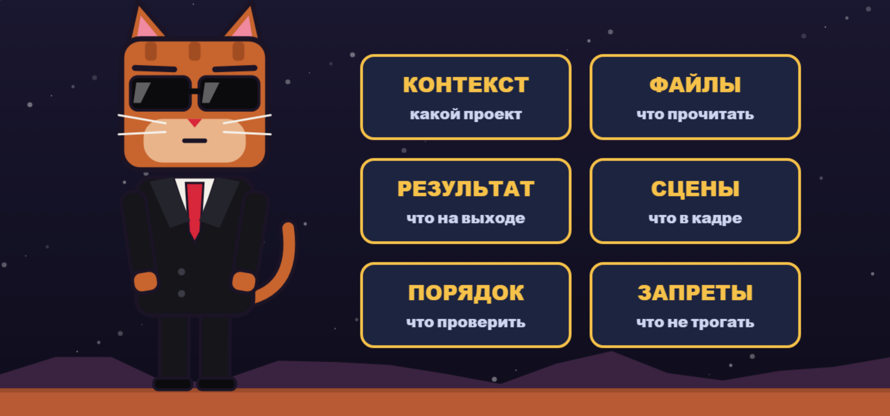

Плохой промпт: «Сделай красивый мультик». Claude Code придётся угадывать почти всё.

Хорошее задание отвечает на шесть вопросов:

1. Контекст: какой это проект.
2. Файлы: что прочитать.
3. Результат: что получить на выходе.
4. Сцены: что показать в каждый момент.
5. Порядок: что проверить до полного рендера.
6. Запреты: что менять нельзя.

Три правила экономят больше всего времени и лимитов

- Описывайте результат, а не код.
- Давайте одну большую задачу по шагам.
- Сначала просите тестовые кадры, потом полный рендер.

Главный шаблон:

```
Ты собираешь вертикальный ролик для Reels.

Прочитай: style.md, stsenarii/rolik-01.md, render/words.json.
Аудио: golos/rolik-01.mp3, музыка: muzyka/fon.mp3.

Результат:
- gotovo/rolik-01.mp4: 1080×1920, 30 fps, H.264 yuv420p, AAC, звук с хвостом 0,8 с;
- gotovo/cover-01.png: обложка 1080×1920.

Технология: Three.js для сцены, Puppeteer для покадрового рендера,
ffmpeg для сборки. Все анимации должны зависеть только от времени t.
Не используй случайные значения без seed.

Субтитры: по 1–3 слова, строго по words.json.
Смена кадра каждые 2–4 секунды, камера всегда немного движется.
Важное держи вне зон интерфейса Instagram: верх 170 px, низ 420 px, правый край 150 px.
Музыка тише голоса примерно на 15–20 дБ.

Порядок работы:
1. Покажи план и проверь окружение.
2. Сделай контрольные кадры по одному на сцену в render/test/.
3. Сам открой их и проверь.
4. Покажи кадры мне и дождись подтверждения.
5. Запусти полный рендер.
6. Проверь файл через ffprobe и напиши отчёт.

Не меняй текст озвучки. Не показывай чужие логотипы и персонажей.
```

### Разбор: плохо и хорошо

| Плохо | Хорошо | Почему лучше |
|---|---|---|
| Сделай красиво | Сделай ночной город, тёплый свет, малая глубина резкости, один акцент оранжевым | Есть конкретный стиль |
| Анимируй героя | Герой поднимает руку на 3-й секунде, держит жест 1 секунду и опускает её | Понятны действие и время |
| Улучши сцену | В сцене 3 добавь передний план и контровой свет. Остальное не меняй | Claude не трогает лишнее |
| Сделай субтитры | Субтитры по 1–3 слова по words.json, крупно, выше нижних 420 px | Текст совпадает с голосом и не мешает интерфейсу |
| Исправь ошибку | Вот текст ошибки. Объясни причину и повтори только сломанный шаг | Claude работает с фактами |
| Сделай длинный ролик | Сначала покажи план и 6 контрольных кадров, потом жди подтверждения | Вы экономите лимиты |

Если не знаете, как описать проблему, вставьте кадр и напишите: «Что здесь мешает? Дай три варианта исправления и не меняй файлы, пока я не выберу».

> ✅ Проверка: в вашем задании есть контекст, файлы, результат, сцены, порядок работы и запреты.

---

## 9.1. Навыки для сильной анимации

Навыки дают Claude Code готовые инструкции для конкретных задач. Для обычного мультика они необязательны, но помогают делать анимацию, 3D-сцены и субтитры сложнее и чище.

Откройте терминал в папке проекта. Если Claude Code запущен, сначала выйдите через /exit. Затем выполните команды:

```
npx skills add heygen-com/hyperframes --skill hyperframes -a claude-code --copy -y
npx skills add remotion-dev/skills --skill '*' -a claude-code --copy -y
claude plugin marketplace add anthropics/skills --scope project
claude plugin install example-skills@anthropic-agent-skills --scope project
```

После установки снова запустите claude. Для HyperFrames нужен Node.js 22 или новее и ffmpeg.

| Набор | Для чего подходит |
|---|---|
| HyperFrames | Видео из HTML, анимация и 3D-сцены с рендером в MP4 |
| Remotion | Анимация на React, субтитры, предпросмотр и рендер |
| example-skills от Anthropic | Дополнительные навыки, включая визуальный дизайн |

Проверьте набор тестовым заданием:

```
Сделай отдельную папку test-skills.
Создай через HyperFrames 5-секундный тест 1080×1920: моя оригинальная 3D-сцена на чёрном фоне.
Создай через Remotion 5-секундный тест 1080×1920: анимированный заголовок и субтитры.
Проверь оба файла через ffprobe и открой контрольные кадры.
```

Устанавливайте только наборы из известных источников: навыки могут запускать команды на компьютере. Для коммерческих проектов проверьте лицензию Remotion: у некоторых компаний она может быть платной.

### 🐱 Навыки и агенты MARS CITY

Это полный набор, на котором работает наш канал. Всё лежит в папке проекта: навыки — в `.claude/skills/`, агенты — в `.claude/agents/`.

**Наши навыки для конвейера мультика** (порядок = путь ролика):

| Навык | Что делает | Как попросить |
|---|---|---|
| video-analyst | Рой агентов разбирает чужой ролик (хук, психология, звук, монтаж, тренды) и пишет оригинальный сценарий | «Разбери этот ролик и сделай похожий мультик без копирования: [ссылка]» |
| ai-art-prompter | Библия стиля и промпты для нейросетей-картинок, чтобы герой не «плыл» | «Сделай карточку героя кота-мэра и промпты на 5 кадров» |
| asset-compressor | Сжимает картинки и звук перед рендером | «Сожми ассеты ролика rolik-01» |
| audio-sync-master | Находит паузы и темп в голосе и музыке, считает тайминги смены кадров | «Посчитай тайминги сцен по golos/rolik-01.mp3» |
| one-click-director | Проверяет все папки, доделывает недостающее и собирает финальный ролик с обложкой | «Собери ролик rolik-01» |

**Навыки для анимации и дизайна:** hyperframes (+ cli, registry, media-use, figma, slideshow, style-sampling, reverse-any-video, remotion-to-hyperframes), 13 навыков Remotion (create, render, captions, markup, maps и др.), frontend-design, canvas-design, algorithmic-art, theme-factory, webapp-testing (проверка страниц и кадров в браузере), skill-creator (создать свой навык), find-skills (найти готовый навык).

**Наши агенты** — запускаются из Claude Code словами «отправь агентам»:

| Агент | Роль |
|---|---|
| va-03 Хук-Мастер | Разбирает первые 3 секунды: понятно ли без звука, есть ли движение |
| va-04 Психолог | Почему досмотрят, напишут коммент, вернутся завтра; риски для детской аудитории |
| va-09 Трендолог | Жив ли тренд, не поздно ли, как не стать копией |
| va-56 Звук | Темп речи, паузы, музыка и эффекты, права на музыку |
| va-78 Визуал | Читаемость на телефоне, длина кадров, стиль, стоимость производства |
| va-10 Режиссёр | Сводит отчёты, устраивает спор между агентами и выдаёт итоговые правки |
| va-11 Прогнозист | Шансы на взлёт 0–100 и прогноз просмотров (плохой / средний / хороший) |
| mc-proverka-kadrov | Чек-лист кадров перед рендером: текст не налезает, цифры сходятся |
| mc-zhiteli | Собирает новые комментарии и добавляет жителей и постройки на карту города |
| mc-oblozhki | 2–3 варианта обложки из готового видео |
| mc-analitik | Ведёт таблицу метрик серий |

Пример, как мы это используем:

```
Отправь сценарий stsenarii/rolik-01.md агентам: хук, психолог, тренды, звук, визуал и прогноз.
Пусть каждый найдёт ошибки и даст шансы на взлёт.
Потом режиссёр пусть устроит спор между отчётами и сведёт итоговые правки.
Файлы сценария не меняй, пока я не выберу правки.
```

---

# Часть 3. Первый ролик

## 10. Сборка ролика

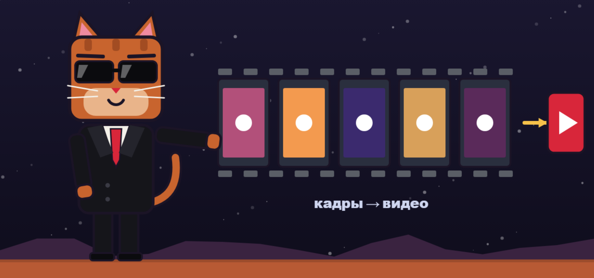

Порядок работы:

1. Запустите claude в папке проекта.
2. Вставьте главный шаблон и замените названия файлов.
3. Прочитайте план.
4. Разрешите установку нужных пакетов, если вы понимаете, что устанавливается.
5. Посмотрите контрольные кадры.
6. Попросите правки конкретными словами.
7. Подтвердите полный рендер.
8. Посмотрите видео со звуком до конца.

Правки пишите точно:

- Плохо: «Сделай лучше».
- Хорошо: «В сцене 3 подними героя на 15% и замени фон на вечерний. Остальное не меняй».

Чек-лист перед публикацией:

- [ ] Размер 1080×1920
- [ ] Хук виден и слышен с первого кадра
- [ ] Субтитры совпадают с голосом
- [ ] Важное не перекрывает интерфейс Instagram
- [ ] Музыка не заглушает голос
- [ ] В ролике нет чужих логотипов и чужих персонажей

Самую удачную сцену можно использовать как основу следующей. Попросите: «Сохрани рабочий рендер как шаблон для следующих роликов и опиши его в README.md».

> 🐱 **Как это сделано у нас.** Мы всегда делаем 2–3 версии и сравниваем: «без правок», «с правками агентов», «короткая». Для «Космодрома» автор выбрал версию с правками на 80 секунд — длиннее, чем советовали агенты, зато в каждой серии 3–5 покупок с ценой и счётчик бюджета. Финальную проверку делает агент mc-proverka-kadrov: текст не налезает на объекты, цифры сходятся, ничего не уходит под интерфейс.

> ✅ Проверка: файл gotovo/rolik-01.mp4 открывается, звук идёт до конца, а ffprobe показывает 1080×1920.

---

## 11. Ошибки и лимиты

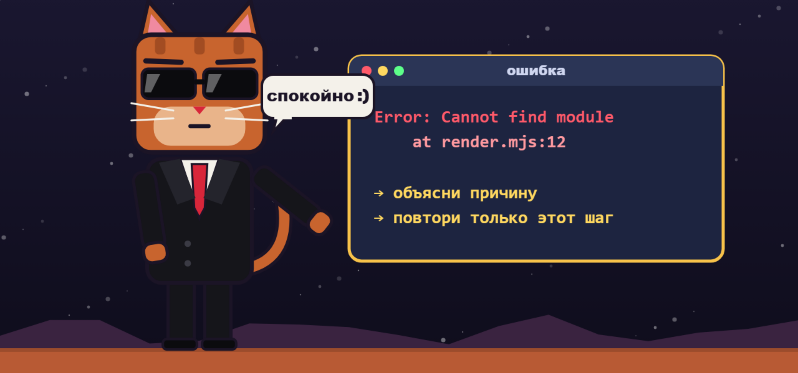

Если что-то пошло не так, не закрывайте окно. Скопируйте ошибку и напишите:

```
Вот ошибка: [текст].
Объясни простыми словами причину, предложи исправление и повтори только сломанный шаг.
```

### Ещё частые ситуации

| Проблема | Что делать |
|---|---|
| claude не найден | Закройте терминал, откройте снова и проверьте установку |
| Claude просит оплату API | Запустите /login и выберите подписку, проверьте ANTHROPIC_API_KEY |
| Рендер идёт очень долго | Попросите упростить дальние объекты и отрендерить только нужный участок |
| Кадры чёрные | Попросите проверить запуск WebGL в браузере без окна |
| Субтитры не совпадают | Получите таймстампы заново и пересчитайте сцены |
| Видео не загружается | Проверьте формат через ffprobe: H.264, yuv420p, AAC |

Как экономить лимиты:

- разбивайте большие ролики на части
- не запускайте полный рендер ради мелкой правки
- просите менять конкретную сцену, а не весь проект
- используйте /clear, когда начинаете новую задачу
- сохраняйте решения в файлы проекта

> ✅ Проверка: вы умеете скопировать ошибку в Claude Code и попросить починить только один шаг.

---

## 12. Публикация

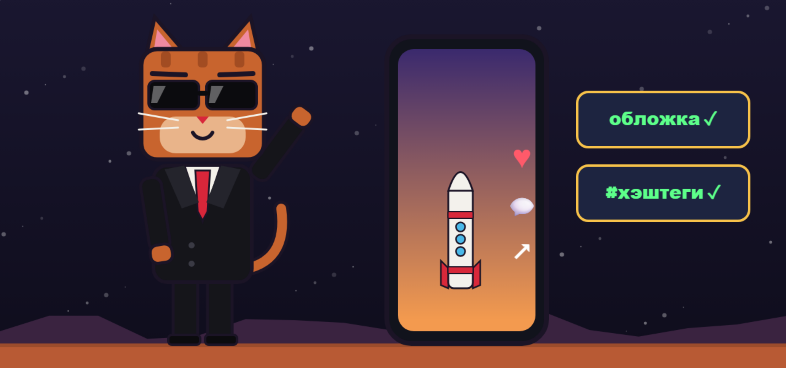

1. Перенесите видео на телефон без сжатия, например через AirDrop или как файл.
2. Посмотрите ролик на телефоне со звуком.
3. Откройте Instagram и создайте Reels.
4. Выберите обложку gotovo/cover-01.png.
5. Напишите короткую подпись и один понятный призыв.
6. Добавьте несколько точных хэштегов.
7. После публикации закрепите комментарий с пояснением, если нужен отклик.

Попросите Claude Code подготовить подпись:

```
На основе stsenarii/rolik-01.md напиши подпись для Reels:
короткий заход, 2–3 строки пользы, один призыв и 5–8 точных хэштегов.
Дай 3 варианта.
```

> 🐱 **Как это сделано у нас.** Один промпт — пакет сразу на три площадки: «Сделай название, описание, теги и закреп для YouTube Shorts, TikTok и Instagram + обложки 9:16 и 16:9». Результат лежит в `stsenarii/<ролик>.publikatsiya.md`. Чтобы посмотреть ролики и обложки с телефона без пересылки, запускаем `node render/telefon.mjs` — он печатает адрес для телефона в той же Wi-Fi сети.

> ✅ Проверка: ролик опубликован, подпись написана, обложка выглядит хорошо на телефоне.

---

# Часть 4. Рост проекта

## 13. Комментарии и подписчики

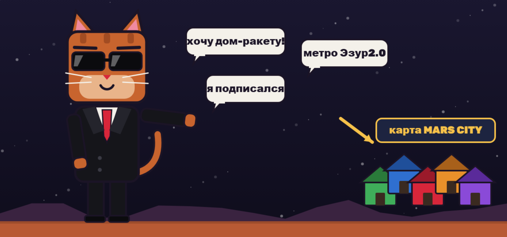

Эти данные помогают делать интерактивные проекты: брать идеи из комментариев, показывать ники в роликах и отвечать на вопросы аудитории. Работайте только со своими аккаунтами и не выгружайте чужие личные данные.

Подписчики: официальная выгрузка. В Instagram откройте Центр аккаунтов, затем «Ваша информация и разрешения» и «Экспорт информации». Выберите JSON и раздел с подписчиками. Подготовка архива может занять время, а файл придёт в уведомлении или на почту.

Комментарии: официальный API. Для своих публикаций в профессиональном аккаунте можно использовать Instagram Graph API. Один запрос возвращает до 50 комментариев, остальные загружаются постранично. Попросите:

```
Помоги подключить официальный Instagram Graph API для моего профессионального аккаунта.
Нужно выгрузить комментарии к моей публикации в comments.json.
Объясняй по одному шагу. Токен храни в .env и не показывай его в чате.
```

Если комментариев мало, их можно скопировать вручную в текстовый файл.

> 🐱 **Рабочий способ MARS CITY.** Комментарии к своим роликам YouTube мы собираем без API и ключей: программа yt-dlp открывает ролики как обычный зритель, а наш скрипт складывает комментарии в базу.
>
> ```
> winget install yt-dlp.yt-dlp
> node render/kommentarii/sobrat.mjs --tolko-novye
> ```
>
> Результат — `render/kommentarii/out/<дата>/comments.json` и `avtory.md` (все пожелания каждого автора). TikTok-комментарии мы присылаем Claude скриншотами. Дальше агент mc-zhiteli сверяет ники с картой, добавляет новых жителей и строит их дома, а просьбы «для города» (метро, железная дорога, парк, полиция) превращает в настоящие объекты на карте.

Скрипты и сторонние сервисы для автоматического сбора данных могут нарушать правила Instagram и привести к ограничениям. Не вводите пароль от Instagram в непроверенные сервисы.

Когда файлы готовы, положите их в папку проекта и напишите:

```
Прочитай comments.json и followers.json.
Убери дубли, сгруппируй запросы по смыслу и покажи главные темы.
Отметь оскорбительные и странные запросы отдельно.
Сохрани таблицу в data/spisok.csv и предложи 5 идей для следующих роликов.
```

> ✅ Проверка: у вас есть список идей из реакции аудитории или понятный способ его собрать.

---

## 14. Перевод в Telegram


Подписчик переходит в Telegram не потому, что вы попросили, а потому что там есть то, что ему нужно. Рабочая схема выглядит так:

1. Сделайте закрытый канал с вступлением по заявкам.
2. Поставьте ссылку на него в профиль Instagram.
3. Дайте в канале то, чего нет в Instagram: полезный файл, сайт проекта или участие в событии.
4. Покажите в ролике, что человек получит, и как пройти путь по шагам.
5. Переносите активность: голосования, ранний доступ и разделы проекта можно давать только внутри канала.
6. Регулярно принимайте заявки, чтобы люди не ждали слишком долго.
7. Не обещайте призы или деньги, если не можете выполнить обещание.

Пример сильной связки: зритель видит результат в ролике, оставляет заявку и получает внутри канала возможность найти своё имя или повлиять на следующий выпуск.

> 🐱 **Как это сделано у нас.** В Telegram лежит интерактивная 3D-карта MARS CITY: каждый подписчик находит свой дом по нику, видит районы YouTube и TikTok, метро, линию фронта с Империей IMEN. Карта — один файл `render/karta/index.html`, Claude обновляет её после каждой серии, а мы выкладываем папку на Netlify перетаскиванием.

> ✅ Проверка: вы можете назвать, что человек получит в Telegram и чего нет в Instagram.

---

## 14.1. Продвинутая работа в Claude Code

Этот раздел можно читать после первого готового ролика. Он помогает реже застревать, быстрее править визуал и тратить меньше лимитов.

### Файл CLAUDE.md

CLAUDE.md загружается в начале каждой сессии. Записывайте туда только короткие правила, которые Claude не поймёт из файлов проекта. Запустите:

```
/init
```

Затем откройте файл через /memory и добавьте правила проекта. Пример:

```
# Мой мультик
- Формат: 1080×1920, 30 fps, H.264 yuv420p, AAC.
- Стиль описан в style.md.
- Сначала делай контрольные кадры, потом полный рендер.
- Не меняй текст озвучки без моего подтверждения.
- Готовые файлы сохраняй в gotovo.
```

> 🐱 **Наши правила, которые Claude запомнил.** «Никаких пересказов прошлых серий — только новые события». «KARAOKE_KOT и кот-мэр — один персонаж, это автор». «Городские просьбы из комментариев (метро, ж/д, парк) — строить объектами, заводы — в заводскую зону». «Космодром — 2D, один голос, табло „N ДНЕЙ ДО СТАРТА“». Достаточно один раз сказать «запомни» — дальше Claude применяет правило сам.

### Команды внутри Claude Code

Доступные команды могут меняться: введите /, чтобы увидеть текущий список. Некоторые команды появляются только в свежих версиях Claude Code.

| Команда | Когда использовать |
|---|---|
| /plan | Перед большой задачей, чтобы сначала увидеть план |
| /context | Посмотреть, что занимает контекст |
| /compact | Сжать длинный разговор и продолжить задачу |
| /clear | Начать новую задачу с чистым контекстом |
| /resume | Вернуться к прошлому разговору |
| /branch | Попробовать другой визуальный вариант, не теряя текущий |
| /rewind | Откатить неудачные изменения к прошлой точке |
| /btw | Задать побочный вопрос, не засоряя основной разговор |
| /usage | Посмотреть расход лимитов |
| /doctor | Проверить установку и настройки |
| /verify | Попросить Claude запустить результат и проверить его |
| /goal | Дать цель, над которой Claude работает до выполнения условия |

### Быстрые клавиши и символы

| Что нажать | Что произойдёт |
|---|---|
| @ | Подсказка файла, чтобы точно указать его в сообщении |
| ! в начале строки | Выполнить команду терминала прямо из Claude Code |
| Ctrl+V | Вставить картинку на Mac и во многих терминалах |
| Alt+V | Вставить картинку на Windows |
| Ctrl+B | Отправить долгую команду в фон |
| Ctrl+R | Найти прошлую команду |
| Esc два раза при пустом поле | Открыть меню отката |

### Как проверять рендер

Попросите Claude показывать доказательства: команду, её вывод и контрольные кадры. Фразы «готово» недостаточно. Также можно проверить файл самостоятельно.

Проверить формат:

```
ffprobe -v error -show_entries stream=codec_name,width,height,r_frame_rate,pix_fmt -show_entries format=duration -of default=nw=1 gotovo/rolik-01.mp4
```

Сделать лист кадров, по одному кадру каждые 3 секунды:

```
ffmpeg -y -i gotovo/rolik-01.mp4 -vf "fps=1/3,scale=270:-1,tile=6x3" -frames:v 1 kontakt.png
```

Вытащить кадр с пятой секунды:

```
ffmpeg -y -ss 5 -i gotovo/rolik-01.mp4 -frames:v 1 kadr.png
```

Сделать лёгкую версию для быстрого просмотра:

```
ffmpeg -y -i gotovo/rolik-01.mp4 -vf scale=540:-2 -c:a copy preview.mp4
```

### Как улучшать визуал

Покажите Claude картинку, что именно не нравится, и назовите конкретное изменение:

```
Посмотри на [Image #1]. Сцена выглядит плоской.
Добавь передний план, глубину резкости и контровый свет.
Меняй только сцену 3. Покажи один контрольный кадр и жди подтверждения.
```

Хорошие слова для запросов: ракурс, композиция, передний план, контровый свет, глубина резкости, темп, пауза, ускорение, замедление, один акцентный цвет.

### Скиллы для своего процесса

Если одну инструкцию вы повторяете каждый раз, сохраните её как свой скилл в .claude/skills/<имя>/SKILL.md. Claude загрузит её, когда она понадобится, поэтому длинный процесс не занимает контекст в каждой сессии.

```
Создай в этом проекте скилл render-check.
Он должен проверять размер, fps, длительность и звук через ffprobe,
делать лист кадров и писать короткий отчёт.
Отчёт сохраняй в render/check.md.
```

Хорошие кандидаты для своих скиллов: проверка ролика, подготовка обложки, создание персонажа, разбор комментариев.

> 🐱 **Наши свои скиллы и агенты** — это как раз такие инструкции: mc-zhiteli (разбор комментариев → карта), mc-oblozhki (обложки), mc-proverka-kadrov (проверка ролика), mc-analitik (метрики). Полный список — в главе 9.1.

### Бесплатное обучение от Anthropic

Если хотите глубже понять инструмент, пройдите Claude Code 101 в Anthropic Academy. Там есть разделы о рабочих процессах, контексте, CLAUDE.md, скиллах и хуках.

---

## 14.2. Шаблон проекта

Чтобы не настраивать каждый проект вручную, создайте основу один раз:

```
Создай в этой папке шаблон проекта для вертикальных мультиков.
Добавь папки stsenarii, golos, muzyka, render, gotovo.
Создай CLAUDE.md, style.md, stsenarii/primer.md и shablony-promptov.md.
В CLAUDE.md запиши: формат 1080×1920, 30 fps, сначала контрольные кадры, не менять текст озвучки без подтверждения.
В style.md оставь поля для героя, палитры, шрифтов, камеры и запретов.
В shablony-promptov.md добавь шаблоны для сценария, тестовых кадров, правки одной сцены и полного рендера.
Не добавляй чужих персонажей, логотипов и защищённой музыки.
В конце покажи дерево файлов.
```

Для нового проекта копируйте всю папку и меняйте style.md и сценарий.

---

## 14.3. Практика

1. Сделайте 15-секундный ролик без озвучки.
2. Сделайте 30-секундный ролик с голосом и субтитрами.
3. Повторите ту же идею в другом стиле.
4. Сделайте ролик по реальному комментарию или вопросу аудитории.

После каждого ролика запишите в CLAUDE.md одно полезное правило, которое сэкономит время в следующий раз.

---

## 15. Что дальше


Сделайте первый ролик короче 30 секунд и доведите его до конца. После этого повторите процесс:

1. Создайте новую папку или скопируйте рабочий шаблон.
2. Обновите style.md под новую тему.
3. Напишите новый сценарий.
4. Используйте те же промпты и проверки.

Чем лучше описаны стиль и рабочий шаблон, тем быстрее выходит каждый следующий мультик.

Если застряли, напишите автору курса: Скопируйте и заполните шаблон ниже.

```
Система: Mac или Windows
Глава и шаг: 
Что я хотел сделать: 
Команда или промпт: 
Что произошло: 
Текст ошибки: 
Что уже пробовал: 
Скриншот: 
```

> 🐱 Автор курса — KARAOKE_KOT, канал MARS CITY. Пиши «МУЛЬТИК» 👉 @KAPAOKE_KOT

---

## Словарь

| Термин | Простыми словами |
|---|---|
| Терминал | Окно, в котором вы вводите команды |
| Claude Code | Программа, которая выполняет задания прямо в вашей папке |
| Промпт | Текст задания для Claude |
| Рендер | Создание видео из кадров |
| Контрольный кадр | Одна картинка для проверки сцены до полного рендера |
| Таймстамп | Точное время слова в озвучке |
| Контекст | То, что Claude держит в памяти в текущем разговоре |
| Скилл | Сохранённая инструкция для повторяющейся задачи |
| CLAUDE.md | Файл с постоянными правилами проекта |
| ffmpeg | Программа для сборки и обработки видео |
| Агент | Отдельный помощник Claude с одной ролью (хук, звук, прогноз…), которого можно отправить разбирать ролик |
| Рой агентов | Несколько агентов, которые разбирают одно и то же и спорят между собой |
